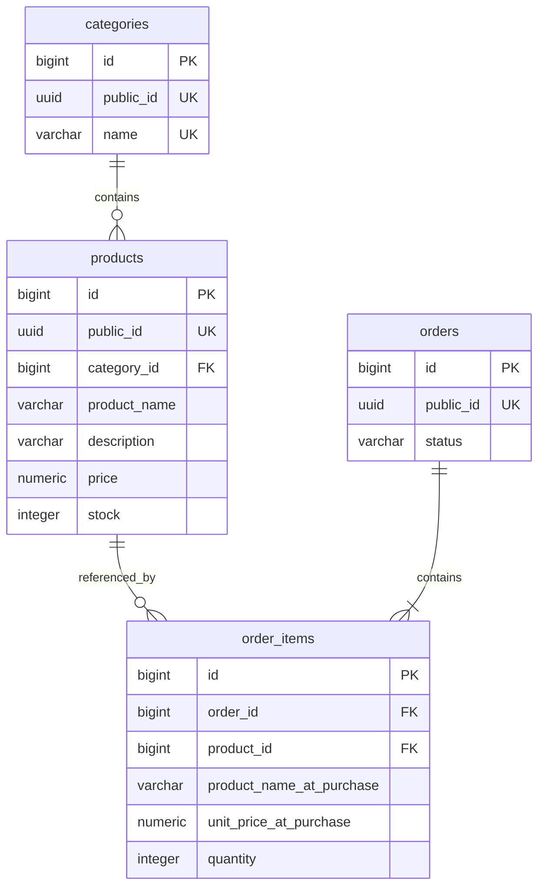

# Лабораторна робота 3 — проєктування бази даних

Статус: схему реалізовано міграціями Liquibase, JPA-сутностями та репозиторіями.
Результати перевірок і команди запуску наведено в LAB3.md.

## Обсяг

База зберігатиме категорії, товари, замовлення та позиції замовлень.
Перенесення кошика в БД не входить до цього етапу.

## Ідентифікатори та сумісність API

Кожна таблиця матиме внутрішній первинний ключ `id BIGINT`, згенерований окремою
PostgreSQL sequence. Зовнішні ключі посилатимуться на ці числові ID.

Для категорій, товарів і замовлень `public_id UUID` буде обов'язковим та унікальним.
UUID створюється застосунком і зберігається без зміни під час оновлення сутності.
У чинному Product API поле `id` і надалі означатиме публічний UUID товару,
а `categoryId` — публічний UUID категорії. Внутрішні числові ID не потрапляють у DTO.
Це дозволяє виконати вимогу щодо sequence без зміни чинного формату API.
Для позицій замовлення окремий публічний UUID поки не потрібний.

## Таблиці та обмеження

Усі поля обов'язкові (`NOT NULL`), крім явно зазначеного `description`.

### categories

| Поле | Тип | Правило |
| --- | --- | --- |
| `id` | `BIGINT` | Первинний ключ, `categories_id_seq` |
| `public_id` | `UUID` | Унікальний публічний ідентифікатор |
| `name` | `TEXT` | Непорожня назва, не лише пробіли, `UNIQUE` |

У поточній моделі Category максимальна довжина назви не обмежена, тому новий
довільний ліміт на цьому етапі не вводиться.

### products

| Поле | Тип | Правило |
| --- | --- | --- |
| `id` | `BIGINT` | Первинний ключ, `products_id_seq` |
| `public_id` | `UUID` | Унікальний публічний ідентифікатор |
| `category_id` | `BIGINT` | Зовнішній ключ на `categories.id` |
| `product_name` | `VARCHAR(120)` | Від 3 до 120 символів, не лише пробіли |
| `description` | `VARCHAR(2000)` | Може бути `NULL` |
| `price` | `NUMERIC(12,2)` | Більше нуля; до 10 цифр у цілій частині |
| `stock` | `INTEGER` | Не менше нуля |

Складене обмеження `UNIQUE(category_id, product_name)` забороняє однакову назву
в межах однієї категорії. У різних категоріях однакова назва дозволена.
Порівняння назв у цій версії буде чутливим до регістру; автоматична зміна регістру
або обрізання пробілів не додаються приховано.

`NUMERIC(12,2)` відповідає чинним обмеженням ProductRequest. Валідація запитів
має й надалі відхиляти зайві десяткові знаки до збереження: сам тип PostgreSQL
не замінює цю перевірку, оскільки може округлити вхідне значення.

### orders

| Поле | Тип | Правило |
| --- | --- | --- |
| `id` | `BIGINT` | Первинний ключ, `orders_id_seq` |
| `public_id` | `UUID` | Унікальний публічний ідентифікатор |
| `status` | `VARCHAR(20)` | `CREATED`, `PAID`, `SHIPPED` або `CANCELLED` |

Статус зберігатиметься текстом, а не порядковим номером Java enum.
Окреме поле загальної суми поки не зберігається: сума обчислюється за позиціями.
Замовлення має містити хоча б одну позицію. Звичайний зовнішній ключ сам по собі
цього не гарантує: правило забезпечуватиме сервіс у межах транзакції та тести.
CRUD позицій не повинен обходити це правило через незалежний публічний сервіс.

### order_items

| Поле | Тип | Правило |
| --- | --- | --- |
| `id` | `BIGINT` | Первинний ключ, `order_items_id_seq` |
| `order_id` | `BIGINT` | Зовнішній ключ на `orders.id` |
| `product_id` | `BIGINT` | Зовнішній ключ на `products.id` |
| `product_name_at_purchase` | `VARCHAR(120)` | Назва товару на момент оформлення, від 3 до 120 символів |
| `unit_price_at_purchase` | `NUMERIC(12,2)` | Ціна одиниці на момент оформлення, більше нуля |
| `quantity` | `INTEGER` | Більше нуля |

Історичні назва та ціна копіюються з товару під час оформлення замовлення.
Зміна поточного товару не оновлює ці поля у вже створених позиціях.
Сума позиції = `unit_price_at_purchase * quantity`; окремого поля суми немає.
Зберігання та перевірки значень виконуватимуться через BigDecimal, без double.

## Чому структура відповідає 3NF

- Кожна таблиця описує окремий тип об'єкта; кожен рядок має первинний ключ.
- Список позицій винесено з orders в окремі рядки order_items.
- Назва категорії зберігається у categories, а не дублюється в products.
- Назва та ціна в order_items описують саме історичну покупку, а не поточний
  стан products. Один товар може мати різні назви й ціни в різних замовленнях,
  тому product_id не визначає ці історичні значення.
- Похідні суми позицій і замовлення не дублюються в колонках.

## Індекси

| Індекс або обмеження | Призначення |
| --- | --- |
| Первинні ключі всіх таблиць | Пошук за внутрішнім ID |
| `UNIQUE(public_id)` у categories, products, orders | Пошук за UUID із API |
| `UNIQUE(categories.name)` | Унікальність назви категорії |
| `UNIQUE(products.category_id, products.product_name)` | Унікальність назви в категорії; підтримка пошуку за category_id |
| B-tree на `products.product_name` | Пошук за точною назвою та сортування за назвою |
| B-tree на `order_items.order_id` | Отримання позицій замовлення |
| B-tree на `order_items.product_id` | Пошук використання товару в замовленнях |

Окремі дублікати індексів для PRIMARY KEY та UNIQUE не створюються.
Індекс на product_name не подається як універсальне прискорення пошуку підрядка.
Додаткові індекси для звітів визначатимуться разом із конкретним запитом.

## Видалення та цілісність

- `products.category_id`: `ON DELETE RESTRICT`. Категорію з товарами видалити не можна.
- `order_items.product_id`: `ON DELETE RESTRICT`. Товар із позиціями замовлення видалити не можна.
- `order_items.order_id`: `ON DELETE CASCADE`. Видалення замовлення видаляє його позиції.
- Створення/оновлення замовлення та його позицій виконується в одній транзакції.
  Помилка будь-якої позиції повинна відкотити всю операцію.
- Для конфліктів видалення та дублювання товарів передбачається HTTP 409 у тих
  операціях, які доступні через API. Перевірки сервісу не замінюють обмежень БД.
- Автоматичне списання залишків під час оформлення замовлення не додається
  без окремо визначеного бізнес-правила.

## План міграцій Liquibase

1. `001-create-market-schema`: чотири sequence, таблиці, первинні й зовнішні ключі,
   NOT NULL та CHECK-обмеження. Крок sequence та allocationSize JPA узгодити
   (початковий варіант — 1). Колонки id мають default nextval відповідної sequence.
2. `002-add-market-indexes`: окремі неунікальні індекси для пошуку та зв'язків.
3. `003-add-category-name-unique`: обов'язкова унікальна назва категорії.
4. `004-add-product-category-name-unique`: складена унікальність товару в категорії
   для додаткового пункту завдання.
5. `005-seed-categories`: початкові категорії зі збереженням чинних UUID:
   - `11111111-1111-1111-1111-111111111111` — Space toys;
   - `22222222-2222-2222-2222-222222222222` — Cosmic food.

UNIQUE для public_id входить у початкову схему. Числові ID початкових категорій
також отримуються із sequence, щоб уникнути розсинхронізації лічильників.
Після застосування changeset не переписується: наступні зміни оформлюються новим.

PostgreSQL і початкова база створюватимуться Docker Compose для локальної роботи
та Testcontainers для тестів. Liquibase створюватиме об'єкти всередині цієї бази.
Hibernate повинен перевіряти схему через ddl-auto=validate, а не змінювати її.

## Подальші перевірки після реалізації

- Міграції застосовуються на порожній PostgreSQL і не дублюються при повторному запуску.
- Sequence генерують ID для всіх таблиць, зокрема після вставки початкових даних.
- Дані, UUID і зв'язки зберігаються після повторного читання та перезапуску застосунку.
- Заборонені значення, дублі назв і порушення зовнішніх ключів відхиляються.
- Однакові назви товарів у різних категоріях дозволені.
- Видалення працює відповідно до RESTRICT/CASCADE.
- Помилка під час запису позиції відкочує замовлення й усі його позиції.
- Зміна ціни та назви товару не змінює історичні дані замовлення.
- Product API зберігає UUID, валідацію та поведінку пагінації.

Natural ID і звіт популярності товарів залишаються окремими додатковими етапами.
Довільна UUID не оголошується бізнесовим Natural ID: для бонусу потрібен осмислений
ключ, наприклад номер замовлення, і перевірений сценарій пошуку за ним.
